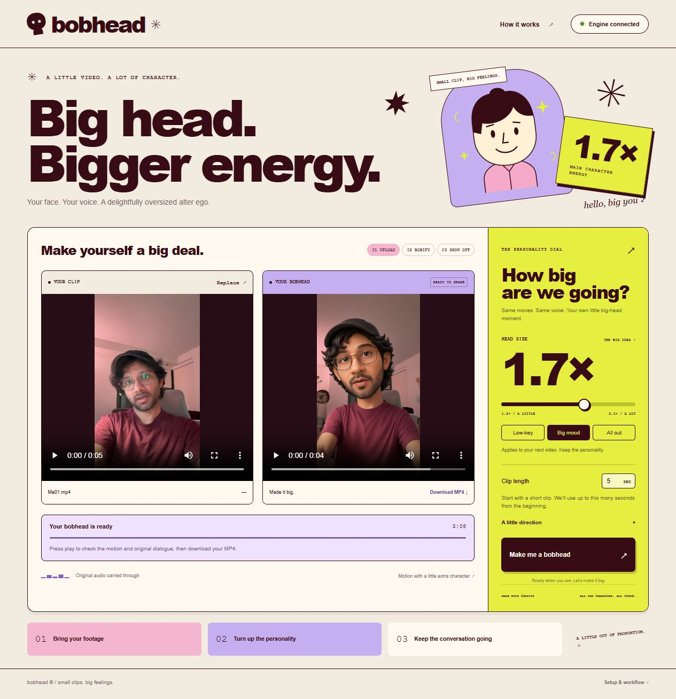
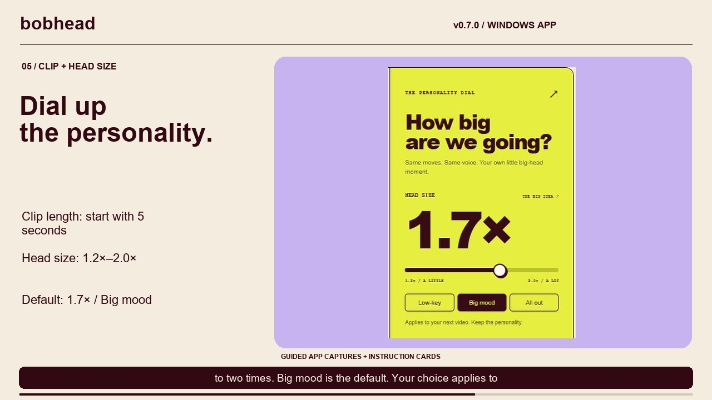
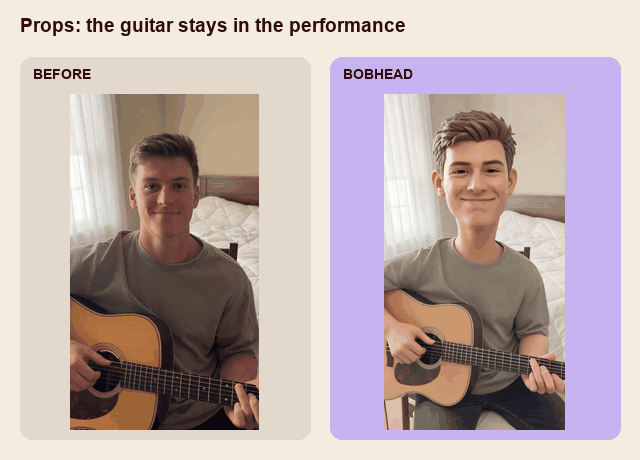
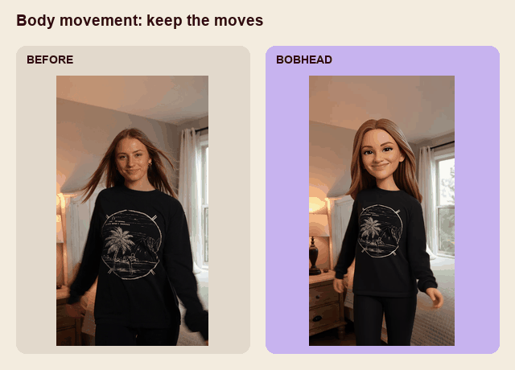
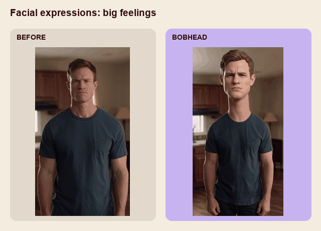
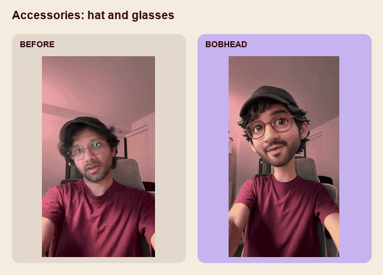
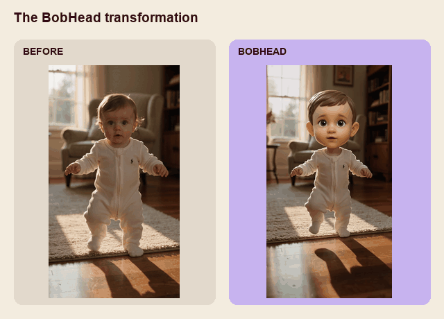

# BobHead

Turn a short video into a playful doll-style BobHead, preserving the performance and original dialogue.

**[Download Start-BobHead.cmd](https://github.com/jalrobustvfx/BobHead/releases/latest/download/Start-BobHead.cmd)** · **[Alternative: Google Drive ZIP (3.41 GB)](https://drive.google.com/file/d/1AybkXAA47niFAuONsnjIE33zdB76Z3DU/view?usp=sharing)** · **[Installation guide](INSTALL.md)** · **[Before/after example files](example%20files)**

## Download and launch

1. Download **Start-BobHead.cmd** from the [latest Windows release](https://github.com/jalrobustvfx/BobHead/releases/latest) into a new, empty folder.
2. Double-click it. It downloads, verifies and extracts the bundled app, Python, ComfyUI and custom nodes, then opens the new interface. No separate ComfyUI installation is needed.
3. On first launch, click **Download required models**. The **15 main files total about 118.9 GB**, plus supporting downloads and working space. Downloads can pause and resume. Model weights are downloaded separately from their publishers.
4. Upload a clip, choose a short duration and a head size from **1.2× to 2.0×** (default **1.7×**), then click **Make me a bobhead**. Preview and download the result.

Keep the folder together and use the same starter for future launches. Completed setup is reused. If you have v06 installed, use a new folder for v07; the new starter installs `BobHead-Standalone-v07`.

**[Watch the narrated download, launch and use guide (1:56)](docs/media/download-launch-use.mp4)** — the current interface and one-file Windows installation, with Higgsfield's Archie voiceover.

## Alternative download: Google Drive

If the starter download fails or stalls, **[download the complete v07 app ZIP from Google Drive](https://drive.google.com/file/d/1AybkXAA47niFAuONsnjIE33zdB76Z3DU/view?usp=sharing)** (about **3.41 GB**).

1. Download `BobHead-Standalone-v07.zip` and choose **Extract All**.
2. Open the extracted `BobHead-Standalone-v07` folder.
3. Double-click **Launch BobHead.cmd**. Python, ComfyUI and custom nodes are included.
4. In the app, click **Download required models** and wait for all 15 main files to show **Installed**. The ZIP excludes model weights, so model downloads still require Internet access.

Keep the extracted folder together and use **Launch BobHead.cmd** for future launches.

## What's new in v07

- Redesigned cream, lavender and lime interface.
- Qwen Image 2.1 creates a doll-style reference from the first processed frame and enlarged OpenPose guide.
- A **1.2×–2.0× head-size slider**, plus presets.
- All three additional Qwen files are included in the model downloader (about **17.3 GB**).

## See it in action

Original footage on the left; BobHead on the right. These silent previews loop automatically. Download each pair to try the source clip or inspect the full result.

### Props: the guitar stays in the performance

[Before MP4](example%20files/a_before.mp4) · [After MP4](example%20files/a_after.mp4)

### Body movement: keep the moves

[Before MP4](example%20files/b_before.mp4) · [After MP4](example%20files/b_after.mp4)

### Facial expressions: big feelings

[Before MP4](example%20files/e_before.mp4) · [After MP4](example%20files/e_after.mp4)

### Accessories: hat and glasses

[Before MP4](example%20files/d_before.mp4) · [After MP4](example%20files/d_after.mp4)

### The BobHead transformation

[Before MP4](example%20files/c_before.mp4) · [After MP4](example%20files/c_after.mp4)

## Troubleshooting

**Startup error about an older BobHead or a busy port?** Follow the [port-conflict troubleshooting steps](INSTALL.md#an-older-bobhead-v06-is-running-on-this-port).

## Requirements

Windows 10/11, an NVIDIA CUDA GPU with a compatible driver, reliable Internet for setup, and space for the runtime, 118.9 GB main models, supporting models, temporary files and outputs. The demonstrated setup uses an **RTX PRO 6000 Blackwell with 96 GiB VRAM**. Minimum VRAM is not established. A separate-machine installation and the complete fresh model download have not been validated.

GitHub's **Source code.zip** contains project source; the release starter installs the complete runtime. See the [source setup guide](docs/DEVELOPMENT.md) if you prefer to connect an existing ComfyUI installation.

## How it works

The first processed frame and enlarged OpenPose guide create the doll-style reference. The custom pose effect controls head size, while the animation follows the source movement. The final MP4 carries the original source dialogue. Optional direction edits the reference-image prompt.

## Source and reproducibility

- [Editable v07 workflow](workflows/BobHead_Comfyui_v07.json) and [compiled app graph](workflows/BobHead_API.json)
- [Custom pose-effect node](custom_nodes/comfyui-pose-effects)
- [Required nodes](NODE_SETUP.md) and [model downloads](MODELS.md)
- [Developer setup and packaging](docs/DEVELOPMENT.md)
- [Recorded runtime versions](environment/installed-packages.txt) and [v07 generation checks](environment/v07-validation.json)

The app passes 21 automated checks covering graph compilation, prompt routing, head-size bounds, downloads and launch behavior. The exact release starter also passed a clean-folder test: checksum verification, archive joining/extraction, and the extracted Python, engine and app startup. The bundled v07 runtime exposes every required node type. A real v07 generation was checked for video decoding and source/result audio. Model weights are not packaged.

Built for the [ComfyUI open-source competition](https://comfy.org/open-source-higgsfield/).

## Credits and licensing

Application code and the custom pose effect use the [MIT license](LICENSE). ComfyUI, third-party nodes, Python packages and models retain their own licenses; see [node sources](NODE_SETUP.md) and [model sources](MODELS.md). Example footage is separate from the software license; see [media notes](docs/media/README.md). Use footage you have permission to process and share.
