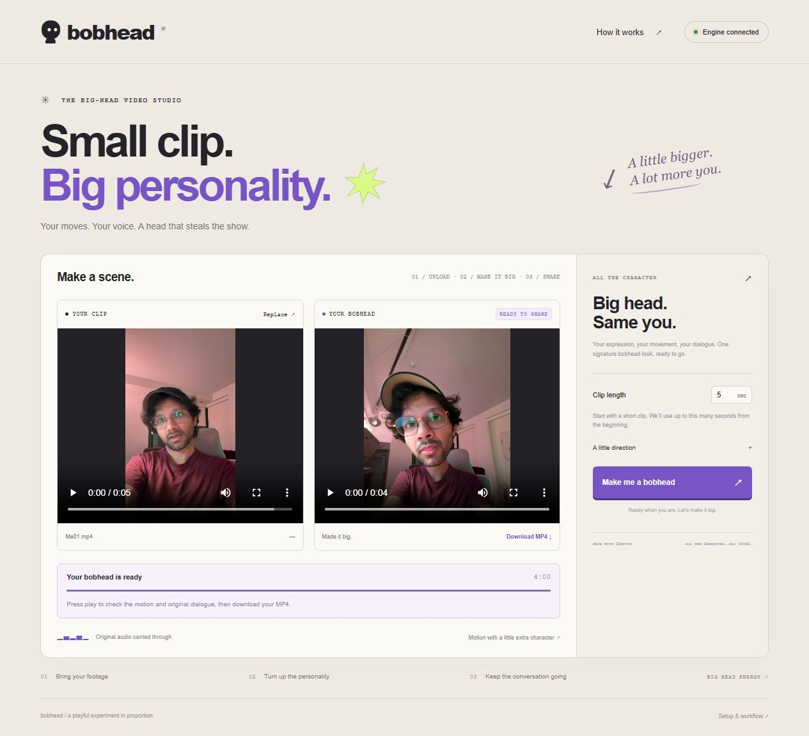
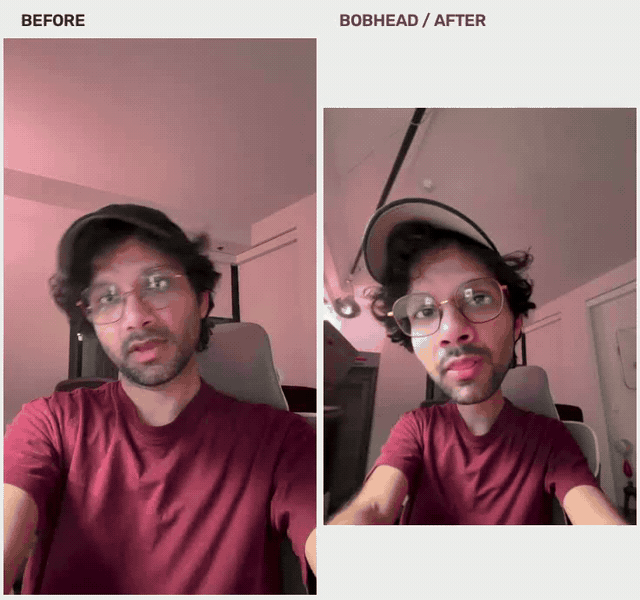

# BobHead

Turn a short video of someone talking into a bobhead video, with an enlarged head, the original head movement, and the original dialogue.

## See it in action

The creator's own footage: original on the left, enlarged-head result on the right. The GIF loops silently; **[watch the comparison with sound](docs/media/before-after.mp4)**.

**[Download the Windows app](https://github.com/jalrobustvfx/BobHead/releases/latest)** · **[Download before and after example files](exmaples%20files)** · **[Watch the 1:55 walkthrough](docs/media/how-to-use-me.mp4)**

Built for the [ComfyUI open-source competition](https://comfy.org/open-source-higgsfield/). This repository includes the app, v06 workflow, custom pose effect, setup instructions, and actual input/output examples.

## Run the app

**[Example files: before.mp4 and after.mp4](exmaples%20files)** — download the source footage to test BobHead and compare it with the enlarged-head result.

**Jury test clip: [Download the original talking video with audio (MP4, 1.1 MB)](https://raw.githubusercontent.com/jalrobustvfx/BobHead/main/docs/media/before.mp4).** This is the supplied `Me01.mp4`, stored here as `before.mp4`. Save the video to your computer, upload it in BobHead, choose **5 seconds**, and click **Make me a bobhead**. Compare your output with the [included result](docs/media/after.mp4).

**New to GitHub? Follow the [download and installation guide](INSTALL.md)** for exactly which file to click and how to set up the app.

1. Open the [latest release](https://github.com/jalrobustvfx/BobHead/releases/latest) and download **Start-BobHead.cmd** into an empty folder on a drive with plenty of space.
2. Double-click **Start-BobHead.cmd**. It downloads and extracts the bundled Windows runtime, verifies the download, and launches BobHead. Python, ComfyUI, and the required custom nodes are included.
3. On the first launch, click **Download required models** in the app. The 12 main model files total approximately **101.6 GB**, with additional supporting downloads on the first generation. Model weights are downloaded from their publishers; they are not included in the app download.
4. Upload a talking-person clip, choose a short duration, and click **Make me a bobhead**. When it finishes, preview and download the result.

Keep the installation folder for future launches. Run the same starter again; completed setup is reused. You do not need your own ComfyUI installation or a folder picker.

**Requirements:** Windows 10/11, an NVIDIA CUDA GPU with a compatible driver, a reliable Internet connection for setup, and space for the runtime, model files, temporary files, and outputs. The demonstrated setup uses an **RTX PRO 6000 Blackwell with 96 GiB VRAM**. The minimum VRAM requirement has not been established; this is a large LTX/Wan workflow. A separate-machine installation has not yet been validated.

See the [illustrated quick start and troubleshooting guide](docs/QUICKSTART.md). GitHub's **Source code.zip** contains the project source; the release starter installs the complete runtime.

## Test with the creator's footage

| Original talking clip | Generated BobHead |
| --- | --- |
| [Download before.mp4](exmaples%20files/before.mp4) | [Download after.mp4](exmaples%20files/after.mp4) |

The source is the creator's own `Me01.mp4`. Upload `before.mp4` in BobHead and choose **5 seconds**. The result uses the original source audio.

## How it works

The workflow takes the first video frame as its reference image. A custom OpenPose effect enlarges the head in the pose guidance, while the video pipeline uses the source motion to animate the result. The final video combines the generated frames with the original source audio.

The app uses workflow **v06**. Head scale is fixed at **1.5** in the custom pose node; there is no size slider. The interface handles uploads, model setup, progress, previews, and downloads locally through ComfyUI.

## Source and reproducibility

- [Editable ComfyUI v06 workflow](workflows/BobHead_Comfyui_v06.json)
- [Compiled API workflow](workflows/BobHead_API.json)
- [Custom pose-effect node](custom_nodes/comfyui-pose-effects)
- [Required node packs and sources](NODE_SETUP.md)
- [Model download locations and licenses](MODELS.md)
- [Developer setup, validation, and packaging](docs/DEVELOPMENT.md)
- [Recorded dependency versions](environment/installed-packages.txt) and [source inventory](environment/source-versions.json)

The app's 16 automated checks pass. The included result was generated with the bundled v06 runtime, and the current example was checked for video decoding and source/result audio. The complete first-time model download has not been rerun from an empty model folder.

## Credits and licensing

BobHead's application code and custom pose effect are provided under the [MIT license](LICENSE). ComfyUI, the third-party custom nodes, Python packages, and model weights retain their own licenses; see [node sources](NODE_SETUP.md) and [model sources](MODELS.md). The bundled runtime preserves third-party license files.

The example footage and demonstration media are separate from the software license; see [media notes](docs/media/README.md). Use footage you have permission to process and share.
