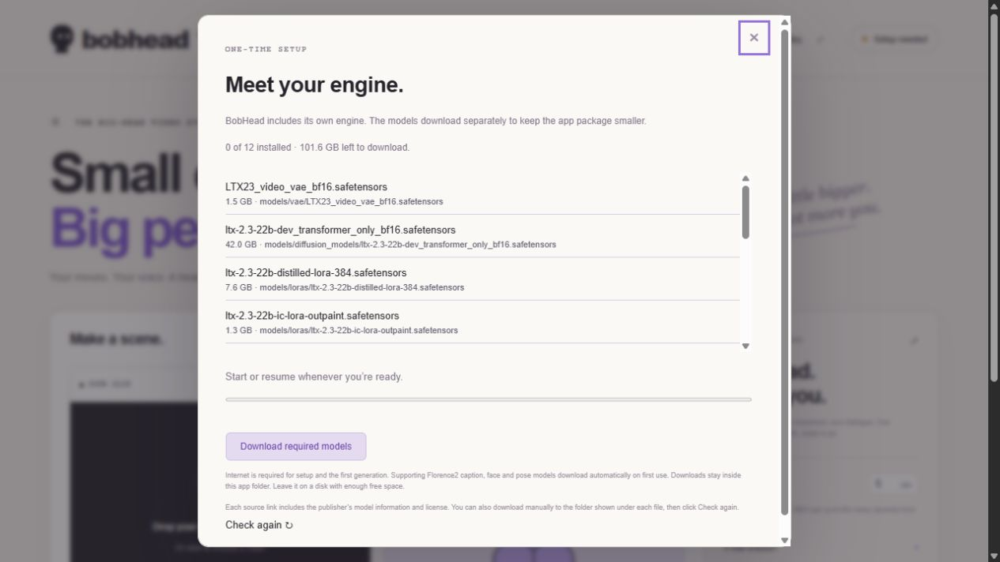
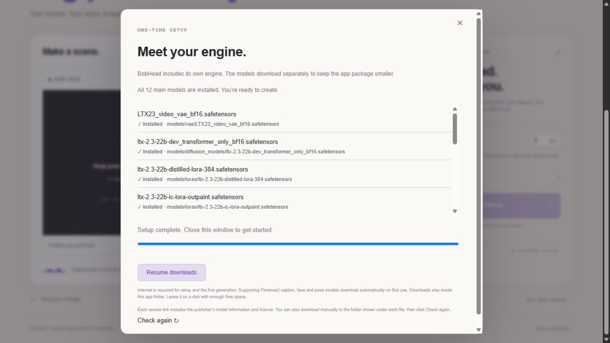
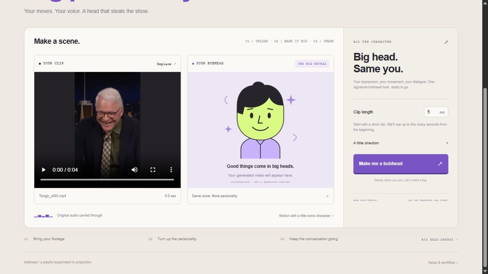

# BobHead quick start

## 1. Launch

Download **Start-BobHead.cmd** from the [latest release](https://github.com/jalrobustvfx/BobHead/releases/latest). Save it in an empty folder on the drive where you want BobHead installed, then double-click it.

The starter downloads two runtime parts, verifies them, and extracts the included Python, ComfyUI, and custom nodes. Keep the window open while setup runs. The app opens in your browser when ready. No existing ComfyUI installation is needed.

On later launches, run the same starter or `Launch BobHead.cmd` inside the extracted app folder. Leave its console open while using the app.

## 2. Download models

Click **Download models**. The main downloads total about **101.6 GB**. Download speed depends on your connection. Keep enough extra space for the extracted runtime, supporting models, temporary files, and generated videos.

Downloads are checked against recorded sizes and SHA256 hashes. The app can pause and resume model downloads. See [MODELS.md](../MODELS.md) for direct publisher links and destination folders if you prefer manual downloads.

Supporting caption, segmentation, and pose models may download when you run the first generation. Keep Internet access available until that finishes.

## 3. Upload and generate

Choose a short clip of a person talking. For a first test, use the included [before.mp4](media/before.mp4), which contains dialogue. Start with approximately five seconds. The app accepts up to 256 MB per upload and supports short selections up to ten seconds.

Choose the duration, optionally enter a description, and click **Make BobHead**. The head size is fixed by the workflow. Leave the app and console running while progress advances. The demonstrated five-second example took around ten minutes on the reference 96 GiB GPU; other hardware and settings can differ considerably.

## 4. Preview and save

Play the result with sound and click the download button to save the MP4. The output includes the original dialogue.

[Watch the narrated walkthrough](media/how-to-use.mp4) · [See the before/after comparison](media/before-after.mp4)

## Troubleshooting

| Symptom | What to do |
| --- | --- |
| Setup download stops | Run the starter again. Verified completed runtime parts are reused; an incomplete part is downloaded again. |
| Not enough disk space | Move the entire installation folder to a larger drive before continuing. Model files alone require around 102 GB. |
| Models still missing | Check the model setup panel and retry the download. Manual files must use the exact filenames and destinations in MODELS.md. |
| First generation seems slow | Supporting models may be downloading. Watch the console and progress display; keep Internet access available. |
| CUDA out of memory | Close other GPU applications and try a shorter clip. Minimum VRAM is unverified; the reference run used 96 GiB. |
| App does not open | Read the launch window for the reported error and the local browser address. Keep the window open. Check that the NVIDIA driver supports the bundled CUDA/PyTorch build. |
| Source checkout cannot launch standalone | Download the release starter. The repository does not include the Python/ComfyUI runtime or model weights. |
| Security software blocks a downloaded starter | Review the source and follow your organization's software policy. Do not disable security protections. |

When reporting a problem, include the error message, GPU/VRAM, Windows version, and whether it happened during setup or generation. Remove private file paths or footage from shared logs.
